<!-- README do perfil: crie/edite em github.com/laradefranca/laradefranca → README.md -->

<div align="center">


<!-- 🐝 Troque esta linha pela abelha final quando ela estiver pronta:

-->

```
01000010 01000101 01000101
   B        E        E
```

<sub>pequena por fora, trabalho de colmeia por dentro</sub>

<br>


</div>

<br>

## ⬡ Sobre mim

Sou estudante de **Sistemas para Internet na UNICAP** e **Técnica em Desenvolvimento de Sistemas pela ETE Porto Digital**.

> Não quero apenas aprender tecnologias. Quero entender como elas resolvem problemas reais.

Este GitHub é meu portfólio e também o registro da minha evolução. Em cada projeto, crio uma **empresa fictícia com um problema de negócio** e desenvolvo uma solução que faça sentido para aquele cenário. Por isso alguns projetos demoram mais para aparecer aqui: prefiro poucos projetos que mostrem como eu penso a muitos projetos superficiais.

<br>

## ⬡ Como construo meus projetos

```mermaid
flowchart LR
    A[Problema de negócio] --> B[Empresa fictícia]
    B --> C[Requisitos]
    C --> D[Modelagem]
    D --> E[Desenvolvimento]
    E --> F[Análise e validação]
    F --> G[Documentação]
    G --> H[Publicação]
    style A fill:#0B1020,stroke:#FFC21A,color:#FFF3B0
    style B fill:#0B1020,stroke:#FFC21A,color:#FFF3B0
    style C fill:#0B1020,stroke:#FFC21A,color:#FFF3B0
    style D fill:#0B1020,stroke:#FFC21A,color:#FFF3B0
    style E fill:#0B1020,stroke:#FFC21A,color:#FFF3B0
    style F fill:#0B1020,stroke:#FFC21A,color:#FFF3B0
    style G fill:#0B1020,stroke:#FFC21A,color:#FFF3B0
    style H fill:#FFC21A,stroke:#E09F00,color:#0B1020
```



<br>

## ⬡ Estudando agora

<table>
<tr>
<td width="50%" valign="top">

**Dados e engenharia de dados**
- Python e Java
- SQL e bancos de dados
- Tratamento e estruturação de dados
- Automação de processos

</td>
<td width="50%" valign="top">

**Análise de dados**
- Power BI e Excel
- Indicadores e visualização
- Análise orientada a problemas de negócio

</td>
</tr>
<tr>
<td valign="top">

**Desenvolvimento**
- Desenvolvimento web
- Programação orientada a objetos
- Estruturação e documentação de projetos

</td>
<td valign="top">

**IA aplicada ao desenvolvimento**
- Uso IA para tirar dúvidas, comparar abordagens e revisar soluções.
- O código e as decisões dos meus projetos são estudados e compreendidos por mim.

</td>
</tr>
</table>

<br>

## ⬡ Ferramentas

<p>


</p>

<sub>Minha stack está em constante evolução: aqui estão as tecnologias que estou estudando e aplicando nos projetos.</sub>

<br>

## ⬡ Para onde vou

| Prazo | Objetivo |
|:--|:--|
| 🍯 **Curto** | Estágio em TI (engenharia de dados, dados e analytics, desenvolvimento web, automação), transformando estudo e projetos pessoais em experiência profissional. |
| 🍯 **Médio** | Base sólida em engenharia de dados: Python, Java, SQL, ETL/ELT, pipelines, cloud e arquitetura de dados. |
| 🍯 **Longo** | Cybersecurity, unindo desenvolvimento, dados, infraestrutura e segurança para construir e proteger sistemas. |

<br>

## ⬡ Projetos

| Projeto | Sobre |
|:--|:--|
| [**Dashboard-Dados**](https://github.com/laradefranca/Dashboard-Dados) | Dashboard interativo da disciplina de programação para web. `JavaScript` |
| [**ArenaShotter3D**](https://github.com/laradefranca/ArenaShotter3D) | Projeto inicial de jogo para o projeto de extensão da UNICAP com o AmanaLab. |

<sub>Cada repositório traz o contexto do problema, a empresa fictícia, os objetivos, as tecnologias, as decisões técnicas, os resultados e os próximos passos.</sub>

<br>

## ⬡ Vamos conversar?

Estou aberta a **estágio em TI**, projetos e networking.

<p>
<a href="http://www.linkedin.com/in/lara-de-franca"></a>
<a href="mailto:laradefranca2007@gmail.com"></a>
</p>

<br>

<div align="center">

**Hoje, estudante. Amanhã, engenheira de dados. No longo prazo, especialista em segurança.**


</div>
